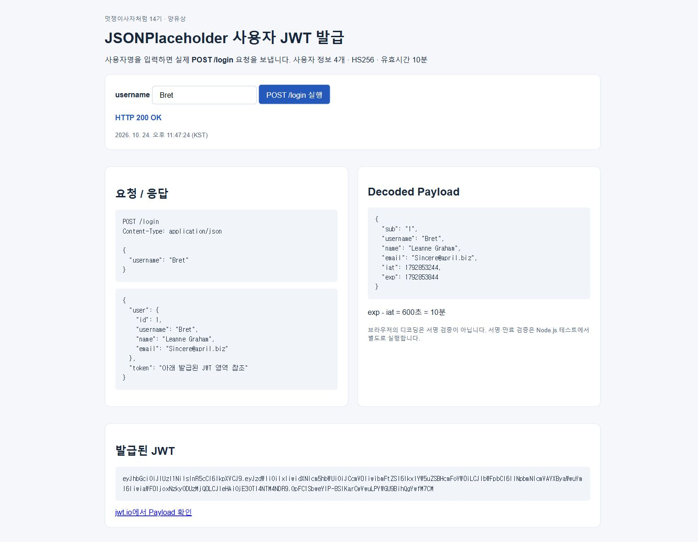
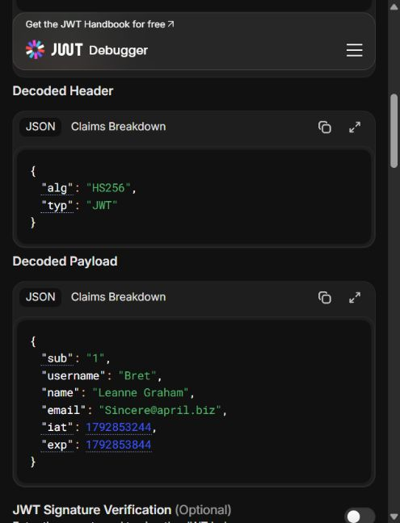

# JWT 발급 과제 | 멋쟁이사자처럼 14기 양유상

JSONPlaceholder에서 username이 정확하게 일치하는 사용자를 찾아, 사용자 정보 4개가 담긴 10분짜리 JWT를 발급합니다.

- 과제 저장소: https://github.com/yangyu0330/likelion-jwt-assignment
- 기본 코드: https://github.com/tjwls11/likelion-jwt (a99dcb605a0aba99ba3061c93adffba7ebc60521)
- 사용자 API: https://jsonplaceholder.typicode.com/users
- Payload 확인: https://jwt.io

## 실행

Node.js 18 이상이 필요합니다. 검증 환경은 Node.js 22.19.0, npm 10.9.3입니다.

```sh
npm ci
node -e "console.log(require('crypto').randomBytes(32).toString('hex'))"
```

`.env.example`을 `.env`로 복사하고 생성한 64자리 문자열을 JWT_SECRET에 입력합니다.

```ini
JWT_SECRET=생성한_64자리_문자열
PORT=3000
```

```sh
npm run dev
```

http://127.0.0.1:3000/demo/ 에서 실제 POST 요청을 보낼 수 있습니다. 서버는 로컬 루프백에 바인딩됩니다.

```http
POST http://127.0.0.1:3000/login
Content-Type: application/json

{"username":"Bret"}
```

응답에는 `token`과 `user`가 들어갑니다. Payload는 `sub`(사용자 id의 문자열), `username`, `name`, `email` 및 자동 생성되는 `iat`, `exp`로 구성됩니다. `exp - iat`는 600초입니다. `phone`, `address`는 포함하지 않습니다.

## 구현

- `src/auth.js`: 외부 API 조회, username 정확 일치 검색, Payload 선택, HS256 / 10m 서명
- `src/server.js`: POST /login, 입력 및 JSON 오류 처리, 데모 페이지 제공
- `public/index.html`: 실제 서버에 요청하는 실습용 UI. 응답·토큰·디코딩된 Payload 표시
- `test/auth.test.js`: 서명, 변조, 만료 경계, 잘못된 입력, 외부 API 실패 검증
- `scripts/verify-live.js`: 실행 중인 서버와 실제 외부 API로 통합 검증
- `docs/evidence/`: 실제 브라우저 캡처와 검증 로그

## 검증

```sh
npm test
# 서버를 별도로 실행한 상태에서:
node scripts/verify-live.js
npm audit
```

실행 결과: 자동 테스트 8개 통과, 실제 HTTP 요청 5개 기대 상태 일치, npm audit 취약점 0건. 검증 시각과 원문은 docs/evidence에 기록했습니다. 만료 테스트는 10분을 기다리는 대신 검증기의 clockTimestamp를 exp-1과 exp로 지정해 경계를 검사합니다.

| 요청 | 상태 |
|---|---|
| Bret | 200 |
| unknown | 404 |
| bret | 404 |
| username 누락 | 400 |
| 숫자 username | 400 |




jwt.io에서는 발급한 토큰의 Payload를 확인했습니다. JWT_SECRET은 외부 사이트에 입력하지 않았습니다. 동일한 캡처 토큰의 서명은 로컬 jwt.verify로 검증했고 결과는 live-check.json에 있습니다. 디코딩과 서명 검증은 서로 다릅니다.

## 실제 트러블슈팅

1. **Bret도 404 반환**: 기본 코드에서 실제 사용자 API를 조회한 뒤 issueToken('Bret', ...)를 호출했지만 `사용자 없음`이 발생했습니다. 원인은 `const user = undefined`였습니다. `users.find(user => user.username === username)`으로 수정한 뒤 실제 HTTP 200을 확인했습니다.
2. **의존성 보안 경고**: 최초 npm install에서 body-parser의 high 취약점 1건(GHSA-27r3-jxmh-p828)이 확인되었습니다. npm audit fix로 body-parser 2.4.0을 적용하고 lockfile을 갱신했습니다. 이후 audit 0건과 전체 테스트 통과를 확인했습니다.
3. **빈 요청 본문 처리 보완**: `req.body.username`에 직접 접근하면 본문이 없는 요청에서 예외가 발생할 수 있어 `req.body?.username`으로 변경했습니다. 실제 HTTP 테스트로 빈 본문과 잘못된 JSON이 400을 반환하는지 확인했습니다.

## 실습 범위

이 과제의 인증은 공개 사용자 데이터에서 username의 존재를 확인하는 실습입니다. 비밀번호를 검증하는 실제 서비스 로그인은 아닙니다. JWT Payload는 암호화되지 않으므로 비밀번호나 시크릿키를 넣지 않습니다. `.env`는 Git 추적에서 제외했습니다. 캡처의 JWT는 10분 후 만료되며 실행할 때마다 새 토큰이 발급됩니다.

## 제출 PDF

[제출 PDF 다운로드](docs/%5B14기%5D%5BJWT실습%5D%5B양유상%5D.pdf)
